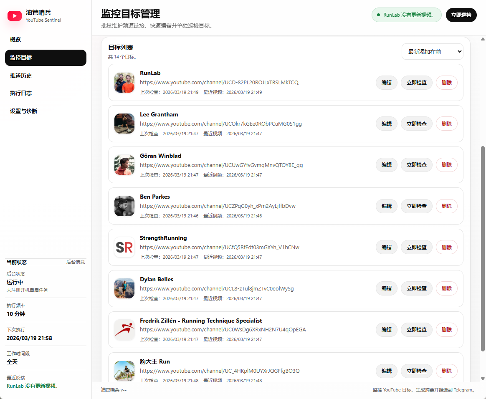

# 油管哨兵 / YouTube Sentinel

一款面向 Windows 的 YouTube 更新监控工具。  
它会在后台定时巡检你指定的 YouTube 目标，发现新视频后尽量提取字幕或元数据，调用 AI 生成中文摘要，并通过 Telegram 推送给你。



## 软件能做什么

- 监控多个 YouTube 目标，支持批量添加
- 后台定时巡检，每个目标每轮只处理最新 1 个新视频
- 优先使用字幕生成摘要，字幕不可用时自动降级
- 支持 Telegram 推送测试、AI 接口测试、网络诊断
- 支持执行日志、推送历史、工作时间段
- 支持开机自动后台运行
- Windows 绿色版，无需安装

## 普通用户请先看这里

### 1. 下载哪个文件

请在 GitHub 的 `Releases` 页面下载 Windows 绿色版压缩包。  
下载文件名类似下面这个的版本即可：

`YouTube Sentinel v1.0.11.zip`

下载后直接解压，不需要安装。

### 2. 正确的首次使用顺序

这个软件依赖后台先正常工作。  
**请先注册开机自启任务，再打开前台界面。**

正确顺序如下：

1. 把压缩包解压到一个固定目录，例如 `D:\YouTube Sentinel`
2. 右键以管理员身份运行 `register-task.bat`
3. 注册完成后，再启动 `YouTube Sentinel.exe`
4. 打开“设置与诊断”，填写：
   - AI Base URL
   - AI API Key
   - AI 模型
   - Telegram Bot Token
   - Telegram Chat ID
5. 点击“保存设置”
6. 先测试 AI 和 Telegram
7. 添加 YouTube 目标
8. 手动执行一次巡检，确认整条链路正常

### 3. 如何取消开机自动后台运行

如果你不再需要开机自启：

1. 右键以管理员身份运行 `unregister-task.bat`

说明：

- 计划任务只负责“开机拉起后台”
- 真正的巡检频率由软件内部调度器控制
- 后台支持无人登录运行

## 重要文件和目录

绿色版根目录大致如下：

```text
YouTube Sentinel/
├─ YouTube Sentinel.exe
├─ register-task.bat
├─ unregister-task.bat
├─ bin/
│  └─ yt-dlp.exe
├─ config/
│  └─ settings.json
├─ data/
│  ├─ sentinel.db
│  └─ avatars/
├─ logs/
└─ ...
```

### 这些目录分别做什么

- `bin/`
  - 放运行依赖的二进制文件
  - 正常发布包里已经包含所需文件
- `config/settings.json`
  - 软件设置文件
  - 保存监控频率、AI、Telegram、界面开关等配置
- `data/sentinel.db`
  - 本地 SQLite 数据库
  - 保存目标列表、视频去重、推送历史、执行日志、诊断结果
- `data/avatars/`
  - 作者头像缓存
- `logs/`
  - 启动日志和运行日志

## 使用说明

### 记录与日志清理

统一入口在“设置与诊断 → 记录与日志清理”。先选择类别，再选择清空全部或保留最近 7 天、1 个月、3 个月、1 年、3 年；点击后确认才会删除。

- 推送记录：推送历史、发送结果及失败明细。
- 执行日志：手动和定时巡检、推送及报错日志。
- 文本运行日志：`logs` 目录中的启动和运行日志。按记录时间过滤，无法识别日期的内容保留；清空全部时才会一起移除。
- 全部记录与日志：以上三类一起清理。监控目标、账号设置和视频去重记录保留。

所有记录仅手动清理，没有自动保留或定时删除。选择类别和范围后点击“清理所选记录”，确认后执行。旧版设置中的自动保留选项会被忽略，已有记录不会按旧到期时间删除。

文本日志清理期间新写入的记录会保留。清理数据库记录不保证数据库文件立刻缩小，SQLite 会复用释放的空间。

“运行诊断”会并行启动各项检查并逐项显示真实进度；蓝色转圈代表检测中，绿色代表正常，红色代表失败，橙色代表超时，灰色问号代表尚未确认。

### YouTube 登录验证与运行依赖

- 发布包需要包含 `bin/yt-dlp.exe` 和 `bin/deno.exe`。Deno 用于 YouTube 的 JavaScript 验证，程序自动调用，无需双击或单独安装。
- 每次抓取自动通过 `--cookies-from-browser firefox` 读取本机 Firefox 最新 Cookies，无需插件、导出 TXT 或手动更新文件。平时在 Firefox 保持 YouTube 登录即可。
- 打开软件界面或注册计划任务时，会自动将当前用户的 Firefox 目录记录到 `config/firefox-source.json`，SYSTEM 后台据此读取正确用户的浏览器。该 JSON 只记录目录，不保存 Cookies。
- Firefox 有多个配置时，在“设置与诊断”的诊断区域选择与 Firefox `about:profiles` 中“正在使用”的配置一致的项目，选择自动保存；登录检测与实际巡检共用同一配置。自动模式优先使用 Firefox 注册的默认配置；存在多个配置且无法确定默认时，不会随意选择。
- 升级覆盖后在目标电脑打开一次新版软件界面即可自动记录本机目录，已有计划任务无需重新注册。
- 如果 YouTube 要求重新登录或网页验证，在 Firefox 中完成后，下次巡检自动使用更新后的 Cookies；无法保证网站永远不要求人工验证。
- “设置与诊断”的诊断列表分别显示“YouTube 登录状态”和“Firefox Cookies 读取”。点击原有“运行诊断”即可重新检测，没有单独卡片或新增按钮；每轮巡检也会自动更新这两项状态。
- 登录检测只读 Firefox 数据库确认 Cookies 可读取，再使用与巡检相同的 yt-dlp 和 Firefox 配置验证需要登录的 YouTube 订阅页，不读取订阅视频内容。网络或内核故障显示“尚未确认”，不会误报为退出登录。检测结果保存在本机 `data` 目录，不保存 Cookies 内容。
- 视频详情只返回摘要所需字段和原始字幕地址，跳过海量自动翻译字幕；子进程缓冲上限为 64 MB。检查失败写入执行日志，顶部提示只保留简短摘要。
- 注册开机计划任务后，无人登录 Windows 图形界面时 SYSTEM 后台仍会运行，Firefox 无需保持打开。每次实际请求 YouTube 时自动重新读取 Cookies，频率跟随监控间隔（默认每轮完成后等待 15 分钟），工作时间段设置仍然生效。

### 关于巡检内容

添加博主时会自动获取头像并写入 `data/avatars` 缓存，批量添加同样生效。首次失败或缓存丢失时，列表加载头像会自动补取，图片请求失败会重试两次，无需重建全量缓存。目标链接未提供头像时会尝试获取所属频道的头像。头像获取失败不会影响添加博主，具体失败原因记录在执行日志；头像显示仍由界面中的头像开关控制。

当前内容分析优先级：

1. 优先使用字幕
   - 包括作者字幕
   - 也包括 YouTube 自动字幕
2. 没有字幕时，退化到简介和章节
3. 还不够时，再退化到标题和少量元数据

推送中的来源等级含义：

- `A`：使用了字幕
- `B`：主要使用简介 / 章节
- `C`：主要使用标题 / 少量元数据

### 关于 AI token 消耗

当前策略是字幕优先。  
这会提升摘要质量，但也意味着：

- 有字幕的视频，AI 输入会更长
- token 消耗通常会高于“只看标题和简介”的方案

程序内部已经做了截断控制，但长视频仍然可能比短视频消耗更多 token。

### 关于代理

当前后台网络请求默认走系统代理。  
如果你的网络环境需要代理，请先确认：

- 系统代理本身可用
- Telegram、AI 接口、YouTube 在该代理下都可访问

## 从源码运行

这一部分主要给技术人员和 AI 使用。

### 环境要求

- Windows
- Node.js 22

### 开发版启动方式

开发版前后台是分开的：

1. 先运行 `dev-worker.bat`
2. 再运行 `dev-ui.bat`

说明：

- 前台不会自动拉起后台
- 后台也不会自动拉起前台

### 常用命令

```bash
npm run typecheck
npm run build
build-release.bat
```

### 打包

执行：

```bat
build-release.bat
```

脚本会：

1. 清空 `dist`
2. 构建前后台
3. 用 `electron-builder` 生成目录版
4. 整理出最终绿色目录 `dist\YouTube Sentinel`
5. 最后等待按键退出

## 面向维护者的技术文档

更详细的实现说明请看：

[`docs/TECHNICAL.md`](docs/TECHNICAL.md)
